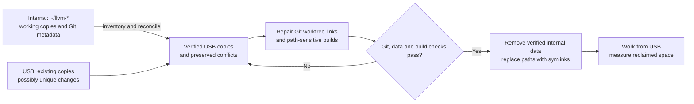

# Move LLVM work to the USB drive

**Current status, November 3:** Migration and archive processing are complete. The active checkout is `/home/will/llvm/llvm-mos-65816`; the other 14 links are alongside it under `/home/will/llvm/`. The actual checkouts remain on USB. Compressed recovery archives remain on the internal drive and USB; use `main-parts/restore-main-v3.py` and `main-parts/RESTORE-v3.txt` under either archive root. The migration archive prefix was removed from R2 after verification; the separate review backup remains there. The USB was ejected and subsequently mounted again at the expected UUID, and the main checkout resolves through its new path. Automatic mounting after reboot has not been tested.

**Method agreed during execution, November 3:** Sync the existing USB copies, finish and check in the paused work from USB, then replace the internal `~/llvm-*` directories with verified compressed archives stored on the internal disk. Process the smallest directories first. Do not create temporary archives on USB. Keep the familiar paths as symlinks to the USB working copies.

The sync completed, and a checksum comparison of 4,096,909 entries found only the expected new review documents and directory timestamps. The paused 0029 and #627/#628 review was completed from USB and checked in as `89eb98d2`; the compiler documentation was pushed and the public dashboard was deployed and verified. All 13 linked sibling worktrees have been replaced by USB links after their compressed internal archives, R2 copies, restore samples, checksum comparisons and Git states were verified. The per-worktree receipts in `/home/will/.llvm-internal-archives-20261103/` record those checks. The standalone `llvm-mos` checkout has also been archived, verified on R2 and switched to USB. At that point the main `llvm-mos-65816` path also pointed to USB; its then-complete internal original was held at `/home/will/.llvm-internal-archives-20261103/llvm-mos-65816` for compression. Its directory metadata archive is verified locally and on R2, including a restored metadata sample; 93 content pieces were planned from smaller to larger. A UUID-based graphical-login mount service is enabled. The independent R2 upload of the review tools and 0029 Git bundle was download-verified. A separate unfinished full-tree R2 stream was stopped when the archive method changed; it is not a completed backup. An incomplete temporary USB archive was stopped and automatically removed.

**R2 cleanup, November 3:** At the user’s request, after verifying the 44 archived data files and matching all 73 accompanying R2 metadata files on USB, the `computer-archive/2026-11-03-llvm-internal-archives/` R2 prefix was deleted and confirmed empty. The separate review backup on R2 remains. Earlier references below to R2 copies document the checks performed before that deletion.

**Path update, November 3:** The 15 home-directory links were moved into `/home/will/llvm/`; the USB directories themselves remain in place. Git worktree registrations were repaired and 19 linked worktrees resolve. Paths shown below under `/home/will/llvm-mos*` describe the earlier layout.

**Completion, November 3:** All 93 main pieces are complete, with verified compressed archives retained internally and copies on USB at `/run/media/will/worktrees/llvm-internal-archives-20261103/`. Receipts and completion records for all pieces match on both drives. The four previously compressed archives remain at their original held internal location; their USB backup names share inodes with the USB working files, so changes through either USB name affect both. The internal filesystem has 102 GiB free and USB has 169 GiB free. Restoring separate pieces does not reconstruct hard links spanning pieces. The UUID-based mount service is enabled. The drive was subsequently ejected and mounted again at the expected UUID; automatic mounting after reboot has not been tested.

**Main-piece progress:** Part `000001` was archived and verified locally and on R2. Removal encountered a read-only directory after some paths were removed; the archive was restored to internal temporary space, all 155,995 remaining entries were compared, and removal completed after three directory permissions were adjusted. Original directory metadata is retained in `000000-directories.tar.zst`; restore it last. The corrected, tested procedure is `main-parts/archive-part-v2.py`, and per-piece receipts record the checks.

**User revision, November 3:** To avoid the long R2 upload and readback for every remaining piece, back up each compressed internal archive to the USB drive and verify the USB copy by SHA-256 before removing its original files. These are retained backup copies, not temporary transfer files. The internal archives and USB backups reside on separate physical devices. Preserve the R2 copies already made; they are not a prerequisite for the remaining pieces. Process remaining archives by increasing total piece size.

**Already-compressed archives:** The four October worktree archives remain unchanged at `/home/will/.llvm-internal-archives-20261103/llvm-mos-65816/archives/llvm-cleanup-archives-2026-10-10/`. Their recorded SHA-256 values passed on both drives. Their USB backup names are hard links to the verified USB files, avoiding another 13 GiB copy. Use `main-parts/restore-main-v3.py` and `main-parts/RESTORE-v3.txt` for the mixed archive set.

### Execution procedure (historical)

The steps below describe the procedure used during migration; the completion and R2 cleanup notes above give the current state.

1. Measure the internal `~/llvm-*` directories and process them in ascending size. The 13 linked siblings measured approximately 0.20–1.75 GiB each when measured individually, `~/llvm-mos` 5.9 GiB, and `~/llvm-mos-65816` 152.8 GiB. Recheck sizes and free space before each item; the internal disk had about 6.7 GiB free when this revision was requested.
2. Create each archive directly on the internal filesystem in `/home/will/.llvm-internal-archives-20261103/`, using a new, non-overwriting name. Use a streaming `tar` and Zstandard archive that retains file contents, Git metadata, modes, ownership, symlinks, sparse files, ACLs, xattrs and hard links within the archive. Preserve every file, including ignored and untracked material. Keep a manifest with the source paths, archive SHA-256, size, commands, and any metadata limitations. Do not overwrite an existing archive or delete the source on a failed command.
3. Verify the compressed stream and compare its extracted contents and applicable metadata with its source. Copy each completed archive to the USB backup directory, read it back and compare its SHA-256, and perform a restore check before removing the corresponding internal data. Preserve the R2 copies already verified; do not wait for new R2 uploads. A partial copy does not satisfy that gate. Check that the USB filesystem UUID and corresponding working copy still match the recorded copy before any replacement.
4. For each verified small directory, switch its familiar path to the matching USB directory and reclaim its internal source only after verification. Keep the archive on the internal disk. Preserve linked-worktree registrations and test the worktree and branch after switching; repair links with Git's supported worktree repair when needed. The separate `/home/will/wt-review-far-word-2` stays in place and must remain registered; do not prune the stale `/tmp` registration as a side effect.
5. The main `llvm-mos-65816` directory is larger than available internal free space. Once smaller items have released space, measure its children and archive them from smallest to largest; split large build or scratch trees further as necessary so each archive fits before its source is removed. Keep the original top-level checkout available until a reversible symlink switch to its verified USB copy is ready. Preserve cross-archive hard-link relationships in a manifest or explicitly record the restore limitation; never assume that separately compressed pieces retain links to each other. Preserve the private worktree archives and all defect baselines and evidence.
6. After each item and again at the end, verify USB mount and symlinks, Git HEAD/status/worktree registrations, representative compiler and smoke tests, and the existence and hashes of the internal archives and their USB backups. Confirm the UUID mount behavior and record any reconnect limitation. Report actual internal space recovered, archive locations and remaining exceptions. The USB checkout is the active working tree; the compressed internal archives and their USB backup copies are recovery material. Earlier R2 copies remain available.

If free space cannot hold the next smallest archive, split it into smaller self-contained pieces or stop and report the exact constraint. Never remove an unverified source to make room. If a source changes while being archived or after its final comparison, repeat the affected verification before replacement. Preserve all historical evidence, earlier credits, and unrelated work.

Plan revision: OpenAI Codex CLI 0.166.0; GPT-6 exact model ID unknown; reasoning effort unknown.


**Original plan status, before the November 3 execution:** Proposed for approval. The original stages below are retained as historical planning and are superseded where they conflict with the current method above.

## Goal and current evidence

Work from the USB drive and reclaim all space occupied by `/home/will/llvm-*` on the internal disk, while preserving the actual Git state, build artifacts, evidence, and unique files on both drives. Keep familiar `~/llvm-*` paths as small symlinks if they prove useful; the data behind them must live on USB.

| Observed on 2026-11-03 | Finding |
| --- | --- |
| Internal filesystem | ext4, 469 GiB total, 1.8 GiB available; reported 100% full. |
| USB filesystem | `/dev/sda1`, ext4, label `worktrees`, UUID `810adfa6-fabb-4d33-a45c-e5c6ace1c71b`, mounted at `/run/media/will/worktrees`; 229 GiB available. |
| USB mount | Host mount is **read-write**. The workspace sandbox presents it read-only; migration writes require access outside that sandbox. `errors=remount-ro` is an ext4 error policy, not evidence of a current error. |
| Directories | Both disks have `llvm-mos`, `llvm-mos-65816`, and 13 similarly named sibling worktrees. Measure each afresh and include any other `~/llvm-*` entries found at execution. |
| Checkout state | Internal main HEAD `c926e069cd4bce06150494a55b2711a62b8652a1`; USB main HEAD `e7301ac712c4f8e88e4197cce4c03c5c45a7124b`. The internal checkout contains modified and untracked files. Neither tree can be assumed to supersede the other. |
| Git links | The USB copy of `llvm-mos-65816-585val/.git` points to `/home/will/llvm-mos-65816/.git/worktrees/...`. Registered worktrees also exist inside `build/` and `.scratch/`, and outside the matching names. |
| Earlier inventory | [October 12 inventory](../investigations/2026-10-12-worktree-disk-inventory.md) measured 164 GiB in the main checkout then; that historical measurement is not a current reclaim estimate. It identifies evidence and archive constraints. |

## Existing worktree and evidence records

The [October 12 inventory](../investigations/2026-10-12-worktree-disk-inventory.md), [archive procedure](../howto-worktree-archive.md), [archive plan](2026-10-12-worktree-r2-archive-flow.md), [September retirement record](../investigations/2026-09-25-worktree-retirement.md), and [October reconciliation](../investigations/2026-10-10-workspace-reconciliation.md) were reviewed on November 3. Their dates and sizes describe earlier states; the current Git registrations and filesystem inventory remain the authority for current paths.

- This project includes live worktrees, not just complete work eligible to park. Relocate active work intact; do not use worktree retirement or branch deletion as a substitute for migration. The existing R2 procedure requires a simulated PR, full archive and verified restore for **parking** a completed linked worktree; its teardown wrapper removes that worktree and cannot by itself relocate the primary checkout. Any proposed retirement remains subject to that separate workflow. The USB cutover needs its own verified relocation procedure that preserves registration, branches, active work, and the independent-backup gate.
- The ignored `archives/llvm-cleanup-archives-2026-10-10/` exists on both drives and contains four private worktree archives and checksums, with receipts outside this repository. Verify the recorded SHA-256 values on both copies; preserve the archives, restore instructions, and external receipts. Presence alone does not verify their bytes. The archive README requires Will's say-so to delete the archives themselves; relocation preserves them.
- The September record references `build/retired-worktrees/2026-09-25/`, which is absent on both currently mounted copies. Locate an independently recoverable copy or explicitly record the unresolved gap; do not claim the historical snapshots are available just because their dated manifests once existed.
- `build/defect-baselines/`, installed and historical compilers, `build/`, `vendor/`, and `.scratch/` can contain irreplaceable binaries, defect evidence, nested repositories and hard-linked artifacts. Preserve them and their hashes; an earlier R2 backup of defect baselines is not a blanket backup of the checkout. The old PR map is incomplete and cannot establish deletion readiness.
- `~/wt-review-far-word-2` is registered against the main repository and has a USB copy, but lies outside `~/llvm-*`. Inventory it and maintain its Git link through relocation; do not delete or move it without including its exact treatment in the cutover. The stale `/tmp/snes-publish-rebased` registration is a separate item; do not prune it as an incidental side effect. Will explicitly paused the 0029 and #627/#628 review on November 3. Its baseline backend build completed with exit 0 immediately before the pause, and no task container remains running. It is no longer a build that must finish before migration; preserve its paused workspace and resume only after verified USB cutover, as described below. Final snapshots still require all other writers, including edits to this plan, to settle.

## Paused 0029 and PR #627/#628 work

Handoff added November 3, 2026 by OpenAI Codex CLI 0.166.0, model `gpt-6-astra`, `xhigh` reasoning effort; verified session `01a19ec9-1366-7e81-b4cb-652aaea68ea4`. Will requested migration first and completion of this review from USB afterward. This section records that task's preservation; it does not certify completion of the main directory migration.

| Item | Preserved state |
| --- | --- |
| Original temporary workspace | `/tmp/llvm-mos-review-20261103`; retain until the main migration is verified. `/tmp` is volatile and is outside the `~/llvm-*` glob. |
| USB workspace | `/run/media/will/worktrees/llvm-mos-review-20261103`; a new, separate directory, not an overwrite of either compiler checkout. Treat it as destination-only work that must be preserved by reconciliation. |
| Copy verification | 68,715 regular files, 3,006,215,530 regular-file bytes; SHA-256 content, complete path sets, types, modes, owners, nanosecond mtimes, symlink targets, xattrs/ACLs and internal hard-link relationships match. No mismatches. No originals deleted. |
| Verification records | `migration-receipt.json` and `migration-source-manifest.json` in the USB workspace. These verify only this paused workspace. Physical extents, atimes and ctimes are not claimed identical. |
| Resume instructions | `RESUME.md` and `progress.json` in the USB workspace, with exact revisions, completed tool hashes, remaining commands and documentation/publication requirements. |
| Compiler state | Exact-main backend and test tools built successfully; current Clang build, current regression runs, candidate build and PR builds remain pending. The source review and test preparation are retained. No current validation pass or refreshed PR readiness is claimed. |

The launcher `run-container.sh` resolves its workspace from its own location. It checks that both the workspace and the canonical compiler repository resolve onto filesystem UUID `810adfa6-fabb-4d33-a45c-e5c6ace1c71b`; it refuses to start from `/tmp` or the old internal-disk checkout. Its default compiler path remains `/home/will/llvm-mos-65816`, so the planned symlink cutover selects the reconciled USB checkout. If the final path changes, set `LLVM_MOS_REVIEW_REPO` to that verified checkout and update this handoff. The guards and shell syntax have been checked; container mount access must be verified after cutover.

Preserve the existing container-side source/build paths when changing host mounts. They are embedded in this build's CMake/Ninja cache; mapping the USB directories onto those same paths avoids an unnecessary full rebuild. Preserve the main checkout's `build/llvm-mos-install`, which the wrapper mounts read-only. The private `source/.git` is a standalone partial clone, not a linked worktree needing registration repair. Keep the complete private `.git`, all overlays, generated build files, inputs, logs and draft material.

The rootless Docker image `llvm-mos-review-20261103` remains available through `/run/user/1000/wf-rootless-docker.sock`; its storage is outside the compiler-directory migration. Its exact identity and Dockerfile are retained in the USB workspace. Do not prune it while the review is paused. This handoff does not authorize changing Docker's storage location or deleting unrelated images.

After the main migration's content, Git and mount checks pass, resume from the USB workspace using `RESUME.md`. Recheck upstream main and both PR heads first, finish Clang, preserve the unpatched tools, then run the baseline/candidate and allocator comparisons. Keep validation paused during final reconciliation. Copy this updated plan into the reconciled checkout as part of the final pass; earlier comparison results predate this edit. PR creation, contribution-branch pushes and review comments remain outside the preparation authorization.

## Destination and transition



**Proposed path mockup**

```text
/home/will/llvm-mos          -> /run/media/will/worktrees/llvm-mos
/home/will/llvm-mos-65816    -> /run/media/will/worktrees/llvm-mos-65816
/home/will/llvm-mos-65816-*  -> matching USB worktrees
/run/media/will/worktrees/   [ext4 USB: authoritative project files]
```

A symlink does not mount the disk: if USB is absent it must fail clearly, and no tool should create a replacement directory on the internal disk. Confirm stable UUID-based mounting, permissions, and login/boot behavior before cutover. Use the existing mount path only if it can be made reliable; otherwise choose a stable mount point and adjust all links consistently. A USB copy is the working copy after cutover, not an independent backup; confirm a separate recoverable backup for unique data before deleting the internal originals.

## Execution stages

1. **Stop and inventory.** Stop builds, editors, sync jobs, and other writers during the final reconciliation. Record `findmnt`, filesystem health, free space, exact sizes and a manifest of all `~/llvm-*` entries and USB counterparts, including hidden, ignored, untracked files, symlinks, hard links, permissions and nested repositories. Capture Git HEAD, branches, refs, remotes, status including staged changes, submodules, worktree registrations and `.git` pointers on both sides. Identify in-use binaries and open processes, and inspect external worktrees such as `~/wt-review-far-word-2`; decide their fate explicitly without silently deleting them. Record independently recoverable backups and verify available USB capacity for unique data, conflicts and temporary files. Stop if capacity or backup is inadequate.
2. **Check USB health and access.** Verify the host mount remains writable, confirm UUID and available space, and check system logs and drive health. The workspace sandbox exposes this external filesystem read-only, so use appropriately authorized access for migration writes. Investigate and resolve any actual errors before proceeding; do not write through a mountpoint when the USB is absent.
3. **Compare and preserve both sides.** Use the visual rsync/sync tool developed in `~` for a read-only comparison and review its exact identity, current capabilities and proposed operation first. `/home/will/rclone-live-backup` (Keepspan) provides a visual comparison and local-destination progress dashboard; its documented local backend uses rclone, while its rsync transport is for SSH destinations. Verify whether this is the intended tool and whether it preserves all required metadata for this local migration. Its default replacement and exclusion behavior can delete destination copies: disable destructive options and automatic source deletion, and do not use mirror/delete or in-place overwrite. Use all applicable visual views: directory and size maps, comparison and conflict views, the transfer dashboard with per-file progress, and the final verification view. Keep the visual dashboard open during transfer and verification; save reviewable comparison and verification reports where available. Preserve USB-only and conflicting files under distinct paths before copying. If the visual tool cannot preserve or verify Git and filesystem fidelity, use an audited suitable copy method with equivalent preview and verification rather than silently weakening the gate.
4. **Copy and independently verify.** Copy every inventoried source, including `.git`, ignored artifacts, evidence and nested worktrees, to the USB while preserving metadata, links and sparse files where supported. Reconcile both directions without overwriting unique data. Run a final quiescent incremental pass and compare file content with checksums, file types, link targets, permissions, ownership, timestamps, ACLs, xattrs, hard-link relationships and sparse allocation as applicable. Investigate every mismatch and record explicit exceptions; rerun after any writes. Do not rely on size, timestamps, a successful transfer exit code, or a Git status alone. Keep existing copies until all gates pass.
5. **Repair and test the relocated project.** On USB, repair linked-worktree metadata using Git's supported worktree repair procedures, including nested and external registrations, without pruning unaccounted worktrees. Verify each worktree's top-level, common Git directory, HEAD, status, refs and representative staged/unstaged/untracked contents against the inventory. Check nested repositories, submodules and Git object integrity. Audit absolute paths in scripts, configuration, CMake caches, symlinks, toolchain installs, task definitions and external consumers. Reconfigure or rebuild path-sensitive build trees on USB as needed; preserve irreplaceable binary evidence and its identity. Run a representative compiler build and existing relevant smoke tests from USB, plus a clean session using the intended familiar path. Verify missing-drive behavior and restoration after reconnect. Recheck no writes changed either side since final verification.
6. **Cut over and reclaim.** After the above gates, close processes holding old directories, retain the verified independent backup, and remove only the inventoried internal originals using a reviewed relocation procedure that preserves Git registration and the project's applicable archive safeguards. Do not invoke the parking/teardown wrapper as a shortcut for moving an active worktree. Replace them with symlinks to the verified USB paths, avoiding any deletion through symlinks. Verify symlinks, mounted filesystem, Git, compiler and workflows again. Measure `df` before and after and report actual reclaimed space, remaining `~/llvm-*` disk usage, exceptions, backup location, and any build trees requiring later rebuilding. Investigate open deleted files if `df` does not reflect the expected gain.

## Approval and rollback gates

```text
[ ] USB health and stable mount checked    [ ] Both copies inventoried
[ ] Unique data backed up and restore tested   [ ] Conflicts preserved
[ ] Full content and metadata verification     [ ] Git links and builds tested
[ ] No active writers; final comparison clean   [ ] Reclaim and symlink cutover
```

Before internal deletion, rollback means stop, leave the internal trees intact, and diagnose or repeat the copy. After deletion, restore from the independently verified backup if the USB fails; symlinks alone are not a backup. If any source or destination changes after the final comparison, repeat the affected verification before removal. This plan's approval authorizes the migration approach; filesystem repair and any commands requiring system privileges still follow the environment's approval mechanism.
